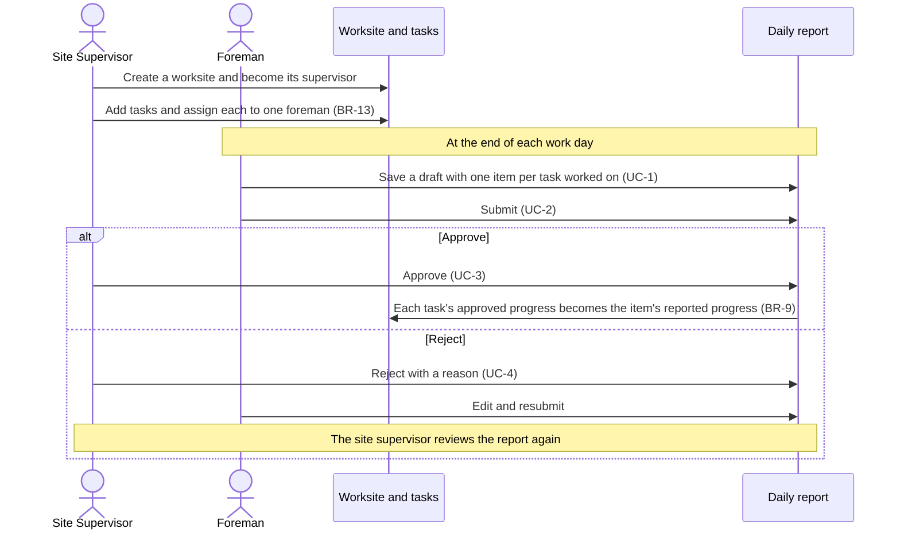
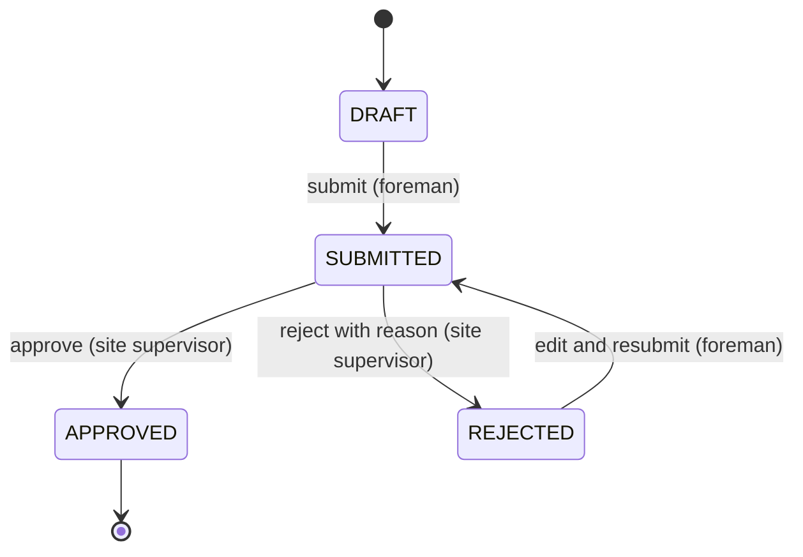
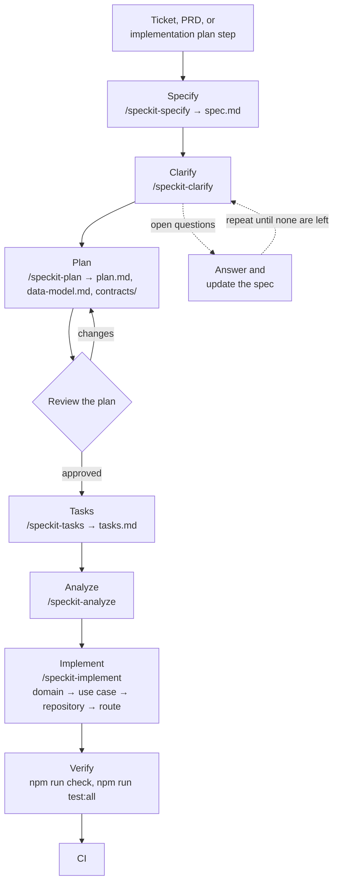

# Worksite Report

A backend for tracking construction progress through daily reports. Foremen report progress on the tasks assigned to them. The site supervisor reviews each report, and task progress changes only when a report is approved.

The project is small on purpose, so it can show how a backend is built end to end: requirements written first, business rules with stable IDs, a layered architecture checked by tools, tests against a real database, and a CI pipeline with security checks.

## 1. The product: what problem it solves

On a construction site, the people doing the work report progress every day, and someone responsible for the site must confirm it. If a reported figure becomes official immediately, a typo or an optimistic estimate ends up in the schedule. Worksite Report separates the two: a foreman **claims** progress in a daily report, and the site supervisor **approves** it. Only approved figures count.

### The flow

The site supervisor sets the worksite up once. After that, the foremen report and the site supervisor reviews, every working day. The steps are described in the [PRD](docs/product/prd.md#flow).



The flow rests on two figures:

- **Reported progress**: the percentage a foreman states for one task, in one item of a daily report.
- **Approved progress**: the official percentage the task keeps. It changes only when a report is approved.

A daily report is one foreman's report for one worksite on one work date. It holds one item per task worked on that day, and every status change is recorded as a transition.

### Use cases

The [use cases](docs/product/use-cases.md) describe what users do.

| ID | Use case | Who | What happens |
| --- | --- | --- | --- |
| UC-1 | Draft a report | Foreman | Picks a worksite and a date, enters progress per task, saves. Can save many times |
| UC-2 | Submit a report | Foreman | Sends a draft or a rejected report for review |
| UC-3 | Approve a report | Site supervisor | Approves. Each task's approved progress becomes its reported progress |
| UC-4 | Reject and resubmit | Both | The supervisor rejects with a reason. The foreman edits and resubmits |
| UC-5 | View a report | Both | Shows the report, its items, and its history of status changes |

Some use cases have measurable acceptance criteria, for example "5 identical requests yield 1 report and 5 identical responses".

### The report lifecycle



A rejected report does not go back to `DRAFT`. The foreman edits it while it is `REJECTED` and resubmits it, so the rejection reason stays in its history.

> **Talking points**
>
> - The core idea is **reported progress vs approved progress**. A foreman's figure is a claim until the supervisor approves it.
> - The lifecycle has four statuses and four allowed transitions. Every other transition is rejected, and every transition records who, when, and why.
> - Requirements were written before any code: a PRD, use cases, and a [glossary](docs/glossary.md) that fixes the vocabulary used in documents, code, and tests.

## 2. Architecture and technology

The application has two modules, `worksite` and `reporting`, in one codebase, built into one Docker image with one HTTP entry point. The full design is in the [architecture document](docs/engineering/architecture.md).

### Technology

| Concern | Choice | Why |
| --- | --- | --- |
| Runtime and language | Node.js 22 LTS, TypeScript 6 in `strict` mode | Long-term support, and types catch errors before tests do |
| HTTP | Express 5 | Familiar and minimal. Version 5 handles errors thrown by async handlers |
| Validation | Zod, at the HTTP boundary only | One schema validates input and produces the TypeScript type and the OpenAPI description |
| Database | PostgreSQL 17 | Constraints, transactions, and time zones the rules depend on |
| Data access | Prisma ORM 6 with Prisma Migrate | Generated types and reviewable migrations |
| Logging | pino | Structured JSON, one line per request |
| Tests | Jest, supertest, Testcontainers | Tests run against a real PostgreSQL in Docker |
| Code quality | Biome, dependency-cruiser | Lint and format in one fast tool, and architecture rules as code |
| Delivery | Docker, Docker Compose, GitHub Actions | One command to run, one pipeline to verify |

Left out on purpose: CQRS, event sourcing, message queues, and a dependency injection container. Dependencies are wired by hand in `main.ts`.

### Coding standard

The rules for writing code are in the [coding standard](docs/engineering/coding-standard.md).

### Domain-Driven Design

Each module follows **Domain-Driven Design (DDD)**:

- **Rules live in one place:** the domain, not routes or queries.
- **Easy to test:** the domain is plain TypeScript, so rules are tested without a database.
- **Code speaks the business language:** `DailyReport` and other glossary terms appear in the spec, the code, and the tests.

The code is split into four layers, with the domain at the center.

```
 interface/        Express routes · Zod request schemas · OpenAPI description
        │
        ▼
 application/      Use cases: one file = one business action
        │
        ▼
 domain/           Aggregates · Entities · Value objects · Repository ports
        ▲          (plain TypeScript, no framework or database imports)
        │
 infrastructure/   Prisma repositories · Mappers

 shared/           Concepts used by every module (actor, clock, errors),
                   database client, configuration, HTTP middleware
```

- `domain` holds the business rules and imports nothing but other domain code. No Express, Prisma, or Zod.
- `application` holds the use cases. Each one loads aggregates through repositories, calls domain methods, and saves the result.
- `infrastructure` implements the repository interfaces (ports) that `domain` declares.
- A module is imported only through its `index.ts`. `worksite` never imports `reporting`.
- These rules are checked by dependency-cruiser on every commit, not just written down.

> **Talking points**
>
> - Every technology choice has one reason. Nothing is there for its own sake.
> - **DDD keeps the rules in one place.** The domain is pure TypeScript, so business rules can be read and tested without Express or a database.
> - **Two modules with clear boundaries.** `reporting` uses `worksite` only through its `index.ts`, and never the other way round.
> - **Optimistic locking** with a `version` column is what makes "no silent overwrites" work without holding database locks.

## 3. Implementation plan

The PRD is built in five steps, one Spec-Kit feature each. Every step delivers one complete use case that can be tested on its own. The full plan, with each step's scope, questions, tests, and exit criteria, is in the [implementation plan](docs/engineering/implementation-plan.md).

| Step | Feature | Delivers | Business rules | Status |
| --- | --- | --- | --- | --- |
| 1 | `001-worksite-seed` | View a worksite and its tasks, from example data | — | Done |
| 2 | `002-draft-and-submit` | UC-1 Draft a report, UC-2 Submit a report | BR-1 to BR-7, BR-11, BR-14, BR-15 | Done |
| 3 | `003-approve-report` | UC-3 Approve a report | BR-5 at approval, BR-9, BR-10, BR-12 | Done |
| 4 | `004-reject-and-resubmit` | UC-4 Reject and resubmit, and the full PRD flow end to end | BR-8 | Done |
| 5 | `005-worksite-management` | Create a worksite, add tasks, assign foremen | BR-13 | Not started |

Each step follows the [workflow](docs/engineering/workflow.md): specify, clarify, plan, tasks, implement. A person approves the output of every step before the next one starts. Inside a step, code is built from the inside out: domain, then use cases, then repositories, then routes, each with its tests.

### Spec-driven development



No task list or code is written until the plan is approved.

> **Talking points**
>
> - **One use case per step.** Each step ends with working, tested behavior, not a half-built layer.
> - **Tables are designed when first needed.** Step 2 adds the report tables, and steps 3 and 4 add none.
> - Every step shares the same exit criteria: `npm run check` and `npm run test:all` pass, every rule has a test named after its ID, and `docker compose up` still works.
> - Step 5 is not built yet, so worksites and tasks come from the example data.
> - **Spec-driven with AI:** the agent drafts specs, plans, and code, but every step has a human approval and an automated check. `AGENTS.md` makes the rules explicit for the agent, for example "never weaken a failing test" and "never resolve a conflict with the documents silently".
> - Every feature leaves a trail: spec → plan → tasks → commits, all citing the same rule IDs.

## 4. See it running

### Start

Requires Docker.

```bash
docker compose up --build
curl http://localhost:3000/health
```

This starts PostgreSQL, applies migrations, loads the example data, and starts the API on port 3000.

| URL | What |
| --- | --- |
| <http://localhost:3000/docs> | Swagger UI |
| <http://localhost:3000/openapi.json> | OpenAPI description |
| <http://localhost:3000/health> | Liveness and database check |

To walk through the PRD example request by request, open [http/report-flow.http](http/report-flow.http) in an editor with an HTTP client. It lists the user, worksite, and task IDs of the example data.

For a live demo from a terminal, open [http/api-demo.html](http/api-demo.html) in a browser. It lists copy-ready `curl` commands for the main flow, with reject and resubmit and the guarantees on request. It needs `curl` and `jq`.

### Reset the data

| Goal | Command |
| --- | --- |
| Put the example's users, worksite, and tasks back to their PRD values. Reports are kept | `npx prisma db seed` (or `docker compose run --rm migrate node dist/prisma/seed.js --reset` without Node.js on the host) |
| Remove all data, including reports | `docker compose down -v`, then start again |

Every start adds only the example rows that are missing and keeps existing data, so progress you change survives a restart.

### API

| Method | Path | Who | Use case |
| --- | --- | --- | --- |
| `GET` | `/worksites/:worksiteId` | Both roles. A foreman sees only their own tasks. | — |
| `PUT` | `/worksites/:worksiteId/reports/:workDate` | Foreman | UC-1 Draft a report |
| `POST` | `/reports/:reportId/submit` | Foreman | UC-2 Submit a report |
| `POST` | `/reports/:reportId/approve` | Site supervisor | UC-3 Approve a report |
| `POST` | `/reports/:reportId/reject` | Site supervisor | UC-4 Reject and resubmit |
| `GET` | `/reports/:reportId` | Both roles | UC-5 View a report |

| Header | Required on | Purpose |
| --- | --- | --- |
| `X-Actor-Id` | Every route except `/health` and `/docs` | The caller's user ID |
| `X-Actor-Role` | Same as `X-Actor-Id` | `FOREMAN` or `SITE_SUPERVISOR`. It must match the user's role. |
| `Idempotency-Key` | Every write | A new unique key per action (BR-14) |

In Swagger UI, **Authorize** sets `X-Actor-Id` and `X-Actor-Role`. Writes to an existing report also send the report's current `version` in the body (BR-15). The request and response shapes are in the [OpenAPI description](http://localhost:3000/openapi.json).

> **Talking points**
>
> - One command starts everything: database, migrations, example data, API.
> - **Changing a percentage in a report does not change the task.** Only an approval does. That is the product rule from part 1, working live.
> - The OpenAPI description is generated from the same Zod schemas that validate requests, and a test checks real responses against it. The documentation cannot drift from the code.
> - Failures are safe: a repeated request returns the stored response, and a write from a stale `version` gets `409`.

## 5. Testing

The [testing guide](docs/engineering/testing.md) defines three layers. Each one proves something the others cannot.

| Layer | Proves | Database | Location |
| --- | --- | --- | --- |
| Unit | Business rules, state transitions, use case logic | None: in-memory fakes and a fixed clock | `test/unit/`, mirroring `src/` |
| Integration | Queries, mapping, constraints, transactions, optimistic locking | Real PostgreSQL in Testcontainers | `test/integration/` |
| API | HTTP contract, roles, validation, idempotency, full flows | Real PostgreSQL in Testcontainers | `test/api/` |

- **Rule IDs in test names:** `BR-5 rejects reported progress below approved progress`. Every rule built so far has tests named after it.
- **Fakes, not mocks.** Each fake implements the same interface as the real repository and lives in `test/fakes/`.
- **A real database.** Integration and API tests never use SQLite or a mocked Prisma client. Testcontainers starts PostgreSQL once per run, applies the real migrations, and every test starts from empty tables.
- **The state machine is table-driven:** all 16 pairs of statuses are tested, allowed or rejected.
- **Concurrency is tested:** approve and reject at the same time, and two saves from the same version. Exactly one wins.
- **Time is fixed:** no test depends on today's date.

```bash
npm test             # unit tests, no Docker needed
npm run test:all     # unit, integration, and API tests, Docker required
```

> **Talking points**
>
> - About 500 tests in three layers. The unit tests run in about a second.
> - **Why a real PostgreSQL:** the guarantees live in the database (unique constraints, conditional updates, transactions). A fake cannot prove them.
> - **Rule-ID test names** make coverage of the requirements visible: `grep "it(\"BR-9"` lists the tests that prove atomic approval.
> - Concurrency tests start both operations together and assert that exactly one wins, without assuming which.

## 6. CI and security

One GitHub Actions workflow, [ci.yml](.github/workflows/ci.yml), runs on every push and pull request. Every step must pass.

| Step | Command or tool | Fails when |
| --- | --- | --- |
| Audit production dependencies | `npm run audit` | A production dependency has a high or critical advisory |
| Typecheck | `npm run typecheck` | TypeScript reports an error |
| Lint and format | `npm run lint` (Biome) | Code breaks a lint rule or is not formatted |
| Architecture | `npm run arch` (dependency-cruiser) | An import breaks a layer or module rule |
| Unit tests | `npm test` | A unit test fails |
| Integration and API tests | Jest with Testcontainers | A test against a real PostgreSQL fails |
| Docker build | `docker build` | The image does not build |
| Image scan | Trivy | The image has a high or critical vulnerability that has a fix |

### Security

- **Dependency audit.** `npm run audit` checks production dependencies only, because dev tools never reach the image. Advisories in Prisma's own dependencies are patched with `overrides` in `package.json`. Run it locally after changing dependencies.
- **Image scan.** Trivy scans OS packages and `node_modules` in the built image. Unfixed vulnerabilities are ignored, because no update can clear them.
- **Small, non-root image.** The runtime image holds production dependencies and compiled code only, with TypeScript and npm removed, and runs as the `node` user.
- **Locked-down workflow.** Third-party actions are pinned to a commit SHA, and the workflow token can only read the repository.
- **Dependency updates.** Dependabot opens weekly pull requests for npm packages, GitHub Actions, and the Docker and Docker Compose images. Major upgrades of Node.js and PostgreSQL are done by hand. Dependabot security updates are a repository setting, under Settings → Code security.
- **No secrets in the repository.** The credentials in `.env.example` and `docker-compose.yml` are local development defaults.

> **Talking points**
>
> - CI runs the same checks as `npm run check`, plus the database tests, the Docker build, and two security gates.
> - **Supply chain:** actions pinned to commit SHAs, a read-only token, and weekly Dependabot updates.
> - **Two different scans:** `npm audit` checks the libraries we chose, and Trivy checks everything in the shipped image, including the OS. Trivy found vulnerabilities in the npm CLI bundled with the Node.js base image, so the runtime image now removes npm.

## 7. Developer guide and contributing

### Set up

Requires Node.js 22 (see `.nvmrc`) and Docker.

```bash
npm ci
cp .env.example .env
docker compose up -d db
npx prisma migrate dev
npm run dev
```

If another PostgreSQL already uses port 5432, set `DB_PORT` in `.env` (for example `55432`) and use the same port in `DATABASE_URL`.

| Script | What it does |
| --- | --- |
| `npm run dev` | Start the API with reload |
| `npm run check` | Typecheck, lint, architecture rules, unit tests |
| `npm run test:all` | Unit, integration, and API tests. Integration and API tests start PostgreSQL with Testcontainers, so Docker must be running |
| `npm run audit` | High and critical advisories in production dependencies, as in CI |
| `npm run build` | Compile to `dist/` |

### Configuration

Read from the environment through [src/config.ts](src/config.ts). Defaults for local development are in [.env.example](.env.example).

| Variable | Purpose |
| --- | --- |
| `DATABASE_URL` | PostgreSQL connection string (required) |
| `PORT` | HTTP port |
| `BACKDATE_LIMIT_DAYS` | How many days back a report can be created (BR-2) |
| `APP_TIME_ZONE` | Time zone used to decide "today" (BR-2) |
| `LOG_LEVEL` | pino log level |
| `DB_PORT` | Host port of the `db` service in Docker Compose |

### Contributing

- Start from a spec in `specs/NNN-name/` for any change in behavior.
- Commit messages follow [Conventional Commits](https://www.conventionalcommits.org/): `feat(reporting): approve a daily report`. One logical change per commit, with its tests.
- Run `npm run check` before opening a pull request, and `npm run audit` after changing dependencies.
- Fill in the [pull request template](.github/pull_request_template.md): summary, changes, the checks you ran, and notes such as migrations.
- Every CI step must pass before a pull request is merged.
- Never edit a committed migration. Create a new one with `npx prisma migrate dev --name <name>`.
- AI coding agents read [AGENTS.md](AGENTS.md), which lists what to read first and what never to do.

> **Talking points**
>
> - A new developer runs five commands, and `npm run check` tells them whether their change is acceptable.

## 8. Simplifications and next steps

This model is deliberately smaller than a real construction workflow.

- Progress is a single percentage per task. Real reports record quantities, labor, weather, materials, and photos.
- Approving a daily report makes progress official. On a real site, quantities are usually confirmed through a separate inspection.
- There are two roles. Real sites also involve owners, consultants, subcontractors, and project managers.
- Approved progress never decreases. Rework would need a separate, explicit adjustment.
- There is no authentication. The caller's identity is supplied in request headers.

Next steps:

| Next step | Why |
| --- | --- |
| Worksite management: create worksites and tasks, assign foremen (BR-13) | Step 5 of the [implementation plan](docs/engineering/implementation-plan.md). Today the worksite comes from example data |
| A list of reports per worksite, filtered by status | A supervisor currently needs the report ID from the foreman |
| Expiry for stored idempotency keys | Keys are kept forever. A retention period of a few days is enough for retries |
| Real authentication | Replace the identity headers with tokens from an identity provider |

> **Talking points**
>
> - Every simplification is a conscious choice, listed in the PRD's "Out of scope", not an accident.
> - The next steps are already shaped as features, so each one would go through the same spec-first workflow.

## Documentation

| Question | Document |
| --- | --- |
| What does it do? | [PRD](docs/product/prd.md), [Use cases and business rules](docs/product/use-cases.md) |
| What do the terms mean? | [Glossary](docs/glossary.md) |
| How is it built? | [Architecture](docs/engineering/architecture.md), [Coding standard](docs/engineering/coding-standard.md), [Testing](docs/engineering/testing.md) |
| How is work done? | [Workflow](docs/engineering/workflow.md) |
| In what order is it built? | [Implementation plan](docs/engineering/implementation-plan.md) |
| Why this way? | [ADRs](docs/adr/) |
