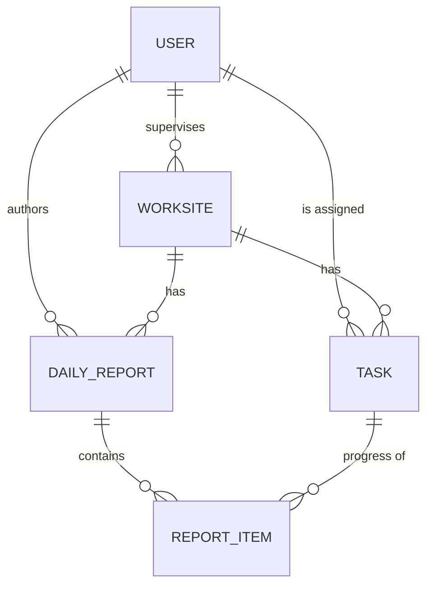
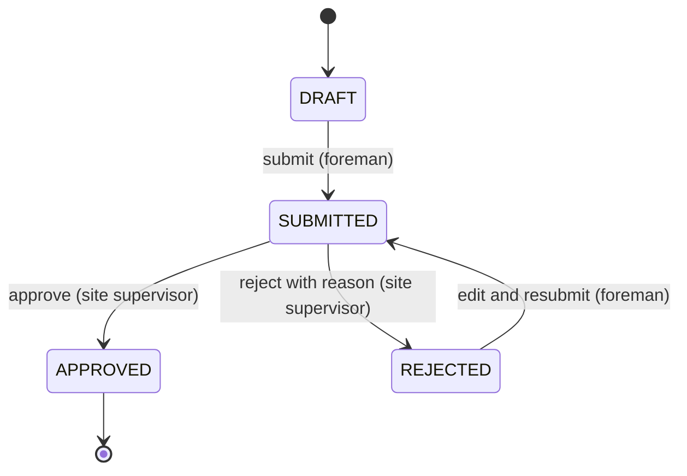

# Worksite Report

A backend for tracking construction progress through daily reports. Foremen report progress on the tasks assigned to them. The site supervisor reviews each report, and task progress changes only when a report is approved.

The project is small on purpose, so it can show how a backend is built end to end: requirements written first, business rules with stable IDs, a layered architecture checked by tools, tests against a real database, and a CI pipeline with security checks.

## Demo at a glance

Each part below ends with **talking points** for presenting it.

| # | Part | What to show | Time |
| --- | --- | --- | --- |
| 1 | [The product](#1-the-product-what-problem-it-solves) | The problem, the two roles, the report lifecycle | 3 min |
| 2 | [Use cases and business rules](#2-use-cases-and-business-rules) | Five use cases, fifteen rules with IDs, three guarantees | 3 min |
| 3 | [See it running](#3-see-it-running) | Swagger UI: draft, submit, approve, then the guarantees live | 5 min |
| 4 | [Architecture and technology](#4-architecture-and-technology) | Modules, layers, request flow, design decisions | 4 min |
| 5 | [Coding standard](#5-coding-standard) | Rules with IDs, enforced by tools | 2 min |
| 6 | [Testing](#6-testing) | Three test layers, real PostgreSQL, rule IDs in test names | 3 min |
| 7 | [CI and security](#7-ci-and-security) | The pipeline and the supply-chain checks | 2 min |
| 8 | [Developer guide](#8-developer-guide-and-contributing) | Setup, the spec-first workflow, contributing | 2 min |
| 9 | [Simplifications and next steps](#9-simplifications-and-next-steps) | What is left out, and why | 1 min |

## 1. The product: what problem it solves

On a construction site, the people doing the work report progress every day, and someone responsible for the site must confirm it. If a reported figure becomes official immediately, a typo or an optimistic estimate ends up in the schedule. Worksite Report separates the two: a foreman **claims** progress in a daily report, and the site supervisor **approves** it. Only approved figures count.

### Two roles

| | Foreman | Site supervisor |
| --- | --- | --- |
| Works on | The tasks assigned to them | The worksites they supervise |
| Reports | Creates, edits, submits, and resubmits their own daily report | Never writes a report |
| Decides | — | Approves a report, or rejects it with a reason |
| Sees | Their own reports, in any status | Reports in their worksites, once submitted |

Each user has exactly one role, so the person who approves a report is never the person who wrote it.

### The model



The model rests on two figures:

- **Reported progress**: the percentage a foreman states for one task, in one item of a daily report.
- **Approved progress**: the official percentage the task keeps. It changes only when a report is approved.

A daily report is one foreman's report for one worksite on one work date. It holds one item per task worked on that day.

### The report lifecycle



A rejected report does not go back to `DRAFT`. The foreman edits it while it is `REJECTED` and resubmits it, so the rejection reason stays in its history.

### The example: a three-storey townhouse

Linda supervises the worksite. Mark and Henry are foremen.

| Task | Assignee | Approved progress |
| --- | --- | --- |
| Pour foundation | Mark | 100% |
| Build ground-floor walls | Mark | 40% |
| Install electrical | Henry | 0% |

On 20 November, Mark reports the walls at 55% and Henry reports electrical at 10%. Linda approves Mark's report, so the walls become 55%. She rejects Henry's with the reason "conduit laid, no wiring pulled yet". Henry corrects the figure to 5% and resubmits, and Linda approves it. The full example is in the [PRD](docs/product/prd.md).

> **Talking points**
>
> - The core idea is **reported progress vs approved progress**. A foreman's figure is a claim until the supervisor approves it.
> - Two roles with separate permissions: whoever writes a report can never approve it.
> - The lifecycle has four statuses and four allowed transitions. Every other transition is rejected, and every transition records who, when, and why.
> - Requirements were written before any code: a PRD, use cases, and a [glossary](docs/glossary.md) that fixes the vocabulary used in documents, code, and tests.

## 2. Use cases and business rules

The [use cases](docs/product/use-cases.md) describe what users do. The business rules are the constraints the system enforces. Every rule has a stable ID, and the same ID appears in the use case, in the code that implements the rule, and in the name of the test that proves it.

### Use cases

| ID | Use case | Who | What happens |
| --- | --- | --- | --- |
| UC-1 | Draft a report | Foreman | Picks a worksite and a date, enters progress per task, saves. Can save many times |
| UC-2 | Submit a report | Foreman | Sends a draft or a rejected report for review |
| UC-3 | Approve a report | Site supervisor | Approves. Each task's approved progress becomes its reported progress |
| UC-4 | Reject and resubmit | Both | The supervisor rejects with a reason. The foreman edits and resubmits |
| UC-5 | View a report | Both | Shows the report, its items, and its history of status changes |

Some use cases have measurable acceptance criteria, for example "5 identical requests yield 1 report and 5 identical responses".

### Business rules

| Group | Rules | In short |
| --- | --- | --- |
| Report validity | BR-1 to BR-5 | One report per foreman, worksite, and day. No future dates, and at most 365 days back. Only active worksites. Only your own tasks. Progress from 0 to 100, and never below approved progress |
| Lifecycle | BR-6 to BR-11 | Only the author edits, and only in `DRAFT` or `REJECTED`. A report needs at least one item to be submitted. A rejection needs a reason. Approval is all or nothing. An approved report is final. Every transition is recorded |
| Permissions | BR-12, BR-13 | Only the worksite's supervisor approves or rejects. Each task has exactly one foreman |
| Data integrity | BR-14, BR-15 | Safe retries and no silent overwrites |

### Three guarantees

| Guarantee | What it means | How | Rule |
| --- | --- | --- | --- |
| **Safe retries** | A request repeated after a network failure never creates a duplicate report. | Every write carries an `Idempotency-Key` header. | BR-14 |
| **No silent overwrites** | A write based on a stale copy of a report is rejected. | Every write sends the report `version` it last read. | BR-15 |
| **Atomic approval** | Approving a report updates every task in it, or changes nothing. | One database transaction across the report and its tasks. | BR-9 |

> **Talking points**
>
> - **Traceability.** BR-5 is defined in the use cases, implemented once in the domain with a `// BR-5` comment, and tested by tests whose names start with `BR-5`. `grep -r "BR-5"` finds all three.
> - **A subtle rule:** BR-5 is checked twice, at submit and again at approval. If the report for the 20th is approved at 60% first, the report for the 19th at 40% can no longer be approved, so progress never goes backwards.
> - The three guarantees are the hard part of the project. They are about **correctness under failure and concurrency**: network retries, two devices editing the same report, and an approval that must not half-succeed.

## 3. See it running

### Start

Requires Docker.

```bash
docker compose up --build
curl http://localhost:3000/health
```

This starts PostgreSQL, applies migrations, loads the example data, and starts the API on port 3000.

| URL | What |
| --- | --- |
| <http://localhost:3000/docs> | Swagger UI |
| <http://localhost:3000/openapi.json> | OpenAPI description |
| <http://localhost:3000/health> | Liveness and database check |

### Example data

| Name | Role | User ID |
| --- | --- | --- |
| Linda | `SITE_SUPERVISOR` | `00000000-0000-4000-8000-000000000001` |
| Mark | `FOREMAN` | `00000000-0000-4000-8000-000000000002` |
| Henry | `FOREMAN` | `00000000-0000-4000-8000-000000000003` |

| Task | Task ID | Assignee |
| --- | --- | --- |
| Pour foundation | `00000000-0000-4000-8000-000000000201` | Mark |
| Build ground-floor walls | `00000000-0000-4000-8000-000000000202` | Mark |
| Install electrical | `00000000-0000-4000-8000-000000000203` | Henry |

The worksite "Three-storey townhouse" is `00000000-0000-4000-8000-000000000101`. Reports are not part of the example data.

### Demo script in Swagger UI

In Swagger UI, **Authorize** sets the `X-Actor-Id` and `X-Actor-Role` headers. Both must belong to the same user. To switch user, click **Logout** and authorize again. Every write needs an `Idempotency-Key`: type a new value for each action, for example `mark-save-1`.

1. **Authorize as Mark.** `GET /worksites/{worksiteId}` shows the walls at 40%.
2. **Save a draft.** `PUT /worksites/{worksiteId}/reports/{workDate}` with today's date and this body. Copy `id` and `version` from the response.

   ```json
   { "items": [ { "taskId": "00000000-0000-4000-8000-000000000202", "reportedProgress": 60 } ] }
   ```

3. **Submit.** `POST /reports/{reportId}/submit` with `{ "version": <version> }`. The walls are still at 40%.
4. **Authorize as Linda and approve.** `POST /reports/{reportId}/approve` with the new `version`.
5. **Check.** `GET /worksites/{worksiteId}` now shows the walls at 60%.

Then show the guarantees:

| Show | Do | Result |
| --- | --- | --- |
| Safe retry | Repeat step 2 with the same key and body | The same response is replayed. Nothing is written twice |
| Reused key | Same key, change `reportedProgress` | `422 IDEMPOTENCY_KEY_REUSED` |
| Stale write | Send a write with an old `version` | `409` conflict. The report is unchanged |
| A rule | As Mark, save a new report for another date with the walls below their approved progress, then submit it | The save works, because a draft checks only the 0 to 100 range. The submit returns `422`, naming the task and its approved progress (BR-5) |
| Permissions | Approve as Mark | `403` |

The same flow, as the PRD's full 20 November example, is in [http/report-flow.http](http/report-flow.http) for an editor with an HTTP client.

### Reset the data

| Goal | Command |
| --- | --- |
| Restore the example to its PRD values, keeping nothing else | `npx prisma db seed` (or `docker compose run --rm migrate node dist/prisma/seed.js --reset` without Node.js on the host) |
| Remove all data, including reports | `docker compose down -v`, then start again |

Every start adds only the example rows that are missing and keeps existing data, so progress you change survives a restart.

### API

| Method | Path | Who | Use case |
| --- | --- | --- | --- |
| `GET` | `/worksites/:worksiteId` | Both roles. A foreman sees only their own tasks. | — |
| `PUT` | `/worksites/:worksiteId/reports/:workDate` | Foreman | UC-1 Draft a report |
| `POST` | `/reports/:reportId/submit` | Foreman | UC-2 Submit a report |
| `POST` | `/reports/:reportId/approve` | Site supervisor | UC-3 Approve a report |
| `POST` | `/reports/:reportId/reject` | Site supervisor | UC-4 Reject and resubmit |
| `GET` | `/reports/:reportId` | Both roles | UC-5 View a report |

| Header | Required on | Purpose |
| --- | --- | --- |
| `X-Actor-Id` | Every route except `/health` and `/docs` | The caller's user ID |
| `X-Actor-Role` | Same as `X-Actor-Id` | `FOREMAN` or `SITE_SUPERVISOR`. It must match the user's role. |
| `Idempotency-Key` | Every write | A new unique key per action (BR-14) |

Writes to an existing report also send the report's current `version` in the body (BR-15). The request and response shapes are in the [OpenAPI description](http://localhost:3000/openapi.json).

> **Talking points**
>
> - One command starts everything: database, migrations, example data, API.
> - **Changing a percentage in a report does not change the task.** Only the approval in step 4 does. That is the product rule from part 1, working live.
> - The OpenAPI description is generated from the same Zod schemas that validate requests, and a test checks real responses against it. The documentation cannot drift from the code.
> - Show one guarantee failing safely: a replayed request, or a `409` on a stale version.

## 4. Architecture and technology

The application is a **modular monolith**: one codebase, one Docker image, one HTTP entry point. It is split into two modules, `worksite` and `reporting`, and each module has four layers taken from Domain-Driven Design.

### Layers

```
 interface/        Express routes · Zod request schemas · OpenAPI description
        │
        ▼
 application/      Use cases: one file = one business action
        │
        ▼
 domain/           Aggregates · Entities · Value objects · Repository ports
        ▲          (plain TypeScript, no framework or database imports)
        │
 infrastructure/   Prisma repositories · Mappers

 shared/           Concepts used by every module (actor, clock, errors),
                   database client, configuration, HTTP middleware
```

- `domain` holds the business rules and imports nothing but other domain code. No Express, Prisma, or Zod.
- `infrastructure` implements the repository interfaces (ports) that `domain` declares.
- A module is imported only through its `index.ts`. `worksite` never imports `reporting`.
- These rules are checked by dependency-cruiser on every commit, not just written down.

### How a write request flows

1. The request logger assigns a request ID.
2. The actor middleware reads `X-Actor-Id` and `X-Actor-Role`, or responds `401`.
3. The idempotency middleware replays the stored response if the key was already used.
4. The route validates the input with Zod and calls exactly one use case.
5. The use case loads aggregates, checks permissions, and calls domain methods, which enforce the rules.
6. The repository writes, conditionally on `version`, in one transaction where needed.
7. The error handler maps domain errors to HTTP responses with one error shape.

### Key design decisions

Each decision is recorded as an [ADR](docs/adr/), with its context and the alternatives considered.

| ADR | Decision | Why |
| --- | --- | --- |
| [0001](docs/adr/0001-ddd-layers-inside-feature-modules.md) | DDD layers inside feature modules | Rules live in one place and are testable without a database |
| [0002](docs/adr/0002-prisma-instead-of-query-builder-or-raw-sql.md) | Prisma instead of a query builder or raw SQL | Type-safe queries and versioned migrations. The hard part is concurrency, not complex queries |
| [0003](docs/adr/0003-optimistic-locking-with-version-column.md) | Optimistic locking with a `version` column | Conflicts are rare, and users hold a report for minutes over mobile networks, so locks would be held too long |
| [0004](docs/adr/0004-one-transaction-across-two-aggregates-on-approval.md) | One transaction across two aggregates on approval | DDD usually says one aggregate per transaction, but BR-9 requires all or nothing |

### Technology

| Concern | Choice | Why |
| --- | --- | --- |
| Runtime and language | Node.js 22 LTS, TypeScript 6 in `strict` mode | Long-term support, and types catch errors before tests do |
| HTTP | Express 5 | Familiar and minimal. Version 5 handles errors thrown by async handlers |
| Validation | Zod, at the HTTP boundary only | One schema validates input and produces the TypeScript type and the OpenAPI description |
| Database | PostgreSQL 17 | Constraints, transactions, and time zones the rules depend on |
| Data access | Prisma ORM 6 with Prisma Migrate | Generated types and reviewable migrations |
| Logging | pino | Structured JSON, one line per request |
| Tests | Jest, supertest, Testcontainers | Tests run against a real PostgreSQL in Docker |
| Code quality | Biome, dependency-cruiser | Lint and format in one fast tool, and architecture rules as code |
| Delivery | Docker, Docker Compose, GitHub Actions | One command to run, one pipeline to verify |

Left out on purpose: CQRS, event sourcing, message queues, and a dependency injection container. Dependencies are wired by hand in `main.ts`.

> **Talking points**
>
> - **Modular monolith, not microservices.** Two modules with clear boundaries give most of the benefit without network calls or distributed transactions. A module could be split out later through its `index.ts`.
> - **The domain is pure TypeScript.** Business rules can be read and tested without Express or a database.
> - **ADR 0004 is a deliberate trade-off:** it breaks a common DDD guideline because a business rule (BR-9) demands it, and the ADR records why.
> - **Optimistic locking** (ADR 0003) is what makes "no silent overwrites" work without holding database locks.
> - Every technology choice has one reason. Nothing is there for its own sake.

## 5. Coding standard

The [coding standard](docs/engineering/coding-standard.md) is a list of rules, each with an ID, a level (`MUST` or `SHOULD`), and how it is checked. Most `MUST` rules are checked by a tool, so a review can focus on design instead of style.

| Area | Example rules | Checked by |
| --- | --- | --- |
| TypeScript (TS) | `strict` mode, no `any`, no `@ts-ignore`, no non-null `!`, every union `switch` is exhaustive | `tsc`, Biome |
| Naming (NAM) | `kebab-case` files. Domain names spelled as in the glossary. A use case file is named after its action: `approve-report.ts` | Biome, review |
| Architecture (ARC) | Layer and module import rules. Rules live in `domain` and cite their ID. One use case per file. Time comes from `Clock`, never `new Date()` | dependency-cruiser, Biome plugin, review |
| Errors (ERR) | Domain errors carry a code and know nothing about HTTP. One place maps them to responses | Review |
| Database (DB) | Uniqueness by database constraint, never check-then-insert. Every report write is conditional on `version`. Multi-row changes use one transaction | dependency-cruiser, review |
| API | Every input validated with Zod. Every write requires an `Idempotency-Key`. Every endpoint described in OpenAPI | `openapi.api.test.ts`, review |
| Logging and config (LOG, CFG) | Shared pino logger, no `console.log`. `process.env` read only in `config.ts` | Biome |
| Git (GIT) | Conventional Commits. One logical change per commit. Behavior changes include their tests | CI, review |

`npm run check` runs every automatic check locally: typecheck, Biome, dependency-cruiser, and unit tests.

> **Talking points**
>
> - **Rules have IDs, like business rules.** A review comment can say "ARC-07" instead of a paragraph.
> - **Enforced, not just written.** Custom Biome plugins (GritQL) block `new Date()` in the domain and unsafe type assertions, and dependency-cruiser fails the build on a wrong import.
> - Constraints in the database, not in application code (DB-02), mean a race condition cannot create a duplicate.

## 6. Testing

The [testing guide](docs/engineering/testing.md) defines three layers. Each one proves something the others cannot.

| Layer | Proves | Database | Location |
| --- | --- | --- | --- |
| Unit | Business rules, state transitions, use case logic | None: in-memory fakes and a fixed clock | `test/unit/`, mirroring `src/` |
| Integration | Queries, mapping, constraints, transactions, optimistic locking | Real PostgreSQL in Testcontainers | `test/integration/` |
| API | HTTP contract, roles, validation, idempotency, full flows | Real PostgreSQL in Testcontainers | `test/api/` |

- **Rule IDs in test names:** `BR-5 rejects reported progress below approved progress`. Every rule built so far has tests named after it.
- **Fakes, not mocks.** Each fake implements the same interface as the real repository and lives in `test/fakes/`.
- **A real database.** Integration and API tests never use SQLite or a mocked Prisma client. Testcontainers starts PostgreSQL once per run, applies the real migrations, and every test starts from empty tables.
- **The state machine is table-driven:** all 16 pairs of statuses are tested, allowed or rejected.
- **Concurrency is tested:** approve and reject at the same time, and two saves from the same version. Exactly one wins.
- **Time is fixed:** no test depends on today's date.

```bash
npm test             # unit tests, no Docker needed
npm run test:all     # unit, integration, and API tests, Docker required
```

> **Talking points**
>
> - About 500 tests in three layers. The unit tests run in about a second.
> - **Why a real PostgreSQL:** the guarantees live in the database (unique constraints, conditional updates, transactions). A fake cannot prove them.
> - **Rule-ID test names** make coverage of the requirements visible: `grep "it(\"BR-9"` lists the tests that prove atomic approval.
> - Concurrency tests start both operations together and assert that exactly one wins, without assuming which.

## 7. CI and security

One GitHub Actions workflow, [ci.yml](.github/workflows/ci.yml), runs on every push and pull request. Every step must pass.

| Step | Command or tool | Fails when |
| --- | --- | --- |
| Audit production dependencies | `npm run audit` | A production dependency has a high or critical advisory |
| Typecheck | `npm run typecheck` | TypeScript reports an error |
| Lint and format | `npm run lint` (Biome) | Code breaks a lint rule or is not formatted |
| Architecture | `npm run arch` (dependency-cruiser) | An import breaks a layer or module rule |
| Unit tests | `npm test` | A unit test fails |
| Integration and API tests | Jest with Testcontainers | A test against a real PostgreSQL fails |
| Docker build | `docker build` | The image does not build |
| Image scan | Trivy | The image has a high or critical vulnerability that has a fix |

### Security

- **Dependency audit.** `npm run audit` checks production dependencies only, because dev tools never reach the image. Advisories in Prisma's own dependencies are patched with `overrides` in `package.json`. Run it locally after changing dependencies.
- **Image scan.** Trivy scans OS packages and `node_modules` in the built image. Unfixed vulnerabilities are ignored, because no update can clear them.
- **Small, non-root image.** The runtime image holds production dependencies and compiled code only, with TypeScript and npm removed, and runs as the `node` user.
- **Locked-down workflow.** Third-party actions are pinned to a commit SHA, and the workflow token can only read the repository.
- **Dependency updates.** Dependabot opens weekly pull requests for npm packages, GitHub Actions, and the Docker and Docker Compose images. Major upgrades of Node.js and PostgreSQL are done by hand. Dependabot security updates are a repository setting, under Settings → Code security.
- **No secrets in the repository.** The credentials in `.env.example` and `docker-compose.yml` are local development defaults.

> **Talking points**
>
> - CI runs the same checks as `npm run check`, plus the database tests, the Docker build, and two security gates.
> - **Supply chain:** actions pinned to commit SHAs, a read-only token, and weekly Dependabot updates.
> - **Two different scans:** `npm audit` checks the libraries we chose, and Trivy checks everything in the shipped image, including the OS. Trivy found vulnerabilities in the npm CLI bundled with the Node.js base image, so the runtime image now removes npm.

## 8. Developer guide and contributing

### Set up

Requires Node.js 22 (see `.nvmrc`) and Docker.

```bash
npm ci
cp .env.example .env
docker compose up -d db
npx prisma migrate dev
npm run dev
```

If another PostgreSQL already uses port 5432, set `DB_PORT` in `.env` (for example `55432`) and use the same port in `DATABASE_URL`.

| Script | What it does |
| --- | --- |
| `npm run dev` | Start the API with reload |
| `npm run check` | Typecheck, lint, architecture rules, unit tests |
| `npm run test:all` | Unit, integration, and API tests. Integration and API tests start PostgreSQL with Testcontainers, so Docker must be running |
| `npm run audit` | High and critical advisories in production dependencies, as in CI |
| `npm run build` | Compile to `dist/` |

### Configuration

Read from the environment through [src/config.ts](src/config.ts). Defaults for local development are in [.env.example](.env.example).

| Variable | Purpose |
| --- | --- |
| `DATABASE_URL` | PostgreSQL connection string (required) |
| `PORT` | HTTP port |
| `BACKDATE_LIMIT_DAYS` | How many days back a report can be created (BR-2) |
| `APP_TIME_ZONE` | Time zone used to decide "today" (BR-2) |
| `LOG_LEVEL` | pino log level |
| `DB_PORT` | Host port of the `db` service in Docker Compose |

### Repository layout

| Path | Contents |
| --- | --- |
| `src/modules/` | The `worksite` and `reporting` modules, each with `domain`, `application`, `infrastructure`, `interface` |
| `src/shared/` | Code used by every module |
| `test/` | Unit, integration, and API tests, fakes, and test data builders |
| `prisma/` | Schema, migrations, example data |
| `specs/` | One folder per feature: spec, plan, data model, contracts, tasks |
| `docs/` | Product, engineering, and decision documents |
| `http/` | Manual walkthrough requests |

### How a feature is built

The [workflow](docs/engineering/workflow.md) is spec-first, using [Spec-Kit](https://github.com/github/spec-kit) with an AI coding agent. Three principles:

1. **The documents come first.** Behavior is defined in `docs/product/` before any code. When code and documents disagree, the disagreement is resolved explicitly, never silently.
2. **The human decides, the agent drafts.** A person reads and approves every spec, plan, and change before the next step starts.
3. **Checks are automated.** A step is done when its check passes, not when someone says so.

| Step | Output | Done when |
| --- | --- | --- |
| Specify and clarify | `specs/NNN-name/spec.md`, citing use case and rule IDs | No open questions left |
| Plan | `plan.md`, `data-model.md`, `contracts/` | The plan follows the architecture rules |
| Tasks and analyze | `tasks.md`, each task citing its rules | Every rule has a task and a test |
| Implement | Code and tests: domain, then use case, then repository, then route | `npm run check` passes |
| Verify and commit | Small commits | `npm run test:all` and CI pass |

Four features were built this way, in `specs/001` to `specs/004`.

### Contributing

- Start from a spec in `specs/NNN-name/` for any change in behavior.
- Commit messages follow [Conventional Commits](https://www.conventionalcommits.org/): `feat(reporting): approve a daily report`. One logical change per commit, with its tests.
- Run `npm run check` before opening a pull request, and `npm run audit` after changing dependencies.
- Fill in the [pull request template](.github/pull_request_template.md): summary, changes, the checks you ran, and notes such as migrations.
- Every CI step must pass before a pull request is merged.
- Never edit a committed migration. Create a new one with `npx prisma migrate dev --name <name>`.
- AI coding agents read [AGENTS.md](AGENTS.md), which lists what to read first and what never to do.

> **Talking points**
>
> - A new developer runs five commands, and `npm run check` tells them whether their change is acceptable.
> - **Spec-first with AI:** the agent drafts specs, plans, and code, but every step has a human approval and an automated check. `AGENTS.md` makes the rules explicit for the agent, for example "never weaken a failing test" and "never resolve a conflict with the documents silently".
> - Every feature leaves a trail: spec → plan → tasks → commits, all citing the same rule IDs.

## 9. Simplifications and next steps

This model is deliberately smaller than a real construction workflow.

- Progress is a single percentage per task. Real reports record quantities, labor, weather, materials, and photos.
- Approving a daily report makes progress official. On a real site, quantities are usually confirmed through a separate inspection.
- There are two roles. Real sites also involve owners, consultants, subcontractors, and project managers.
- Approved progress never decreases. Rework would need a separate, explicit adjustment.
- There is no authentication. The caller's identity is supplied in request headers.

Next steps:

| Next step | Why |
| --- | --- |
| Worksite management: create worksites and tasks, assign foremen (BR-13) | Step 5 of the [implementation plan](docs/engineering/implementation-plan.md). Today the worksite comes from example data |
| A list of reports per worksite, filtered by status | A supervisor currently needs the report ID from the foreman |
| Expiry for stored idempotency keys | Keys are kept forever. A retention period of a few days is enough for retries |
| Real authentication | Replace the identity headers with tokens from an identity provider |

> **Talking points**
>
> - Every simplification is a conscious choice, listed in the PRD's "Out of scope", not an accident.
> - The next steps are already shaped as features, so each one would go through the same spec-first workflow.

## Documentation

| Question | Document |
| --- | --- |
| What does it do? | [PRD](docs/product/prd.md), [Use cases and business rules](docs/product/use-cases.md) |
| What do the terms mean? | [Glossary](docs/glossary.md) |
| How is it built? | [Architecture](docs/engineering/architecture.md), [Coding standard](docs/engineering/coding-standard.md), [Testing](docs/engineering/testing.md) |
| How is work done? | [Workflow](docs/engineering/workflow.md) |
| In what order is it built? | [Implementation plan](docs/engineering/implementation-plan.md) |
| Why this way? | [ADRs](docs/adr/) |
