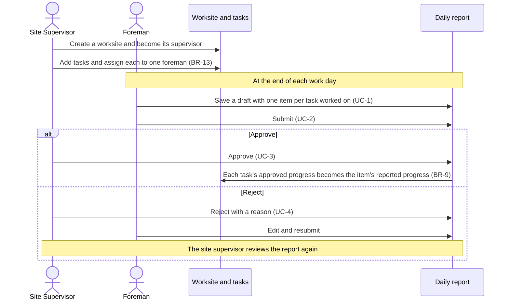
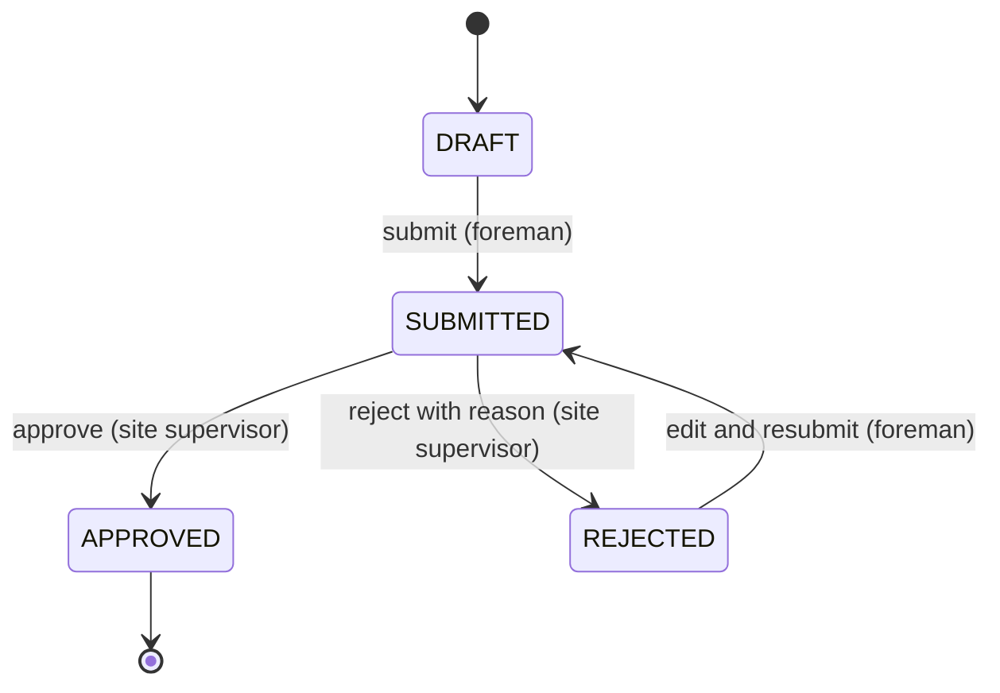

# Worksite Report: PRD

Worksite Report tracks construction progress through daily reports. Foremen report progress on the tasks assigned to them. The site supervisor reviews each report, and task progress changes only when a report is approved.

Related documents:

- [Use cases](./use-cases.md): main flows, acceptance criteria, and business rules BR-1 to BR-15
- [Glossary](../glossary.md): definitions of every term used here
- [Implementation plan, section 2.1](../engineering/implementation-plan.md#21-domain-model): the domain model, with every entity and relationship

## Flow

The site supervisor sets the worksite up once. After that, the foremen report and the site supervisor reviews, every working day.

1. **Set up.** The site supervisor creates a worksite, adds its tasks, and assigns each task to one foreman.
2. **Report.** At the end of a work day, each foreman writes one daily report per worksite, with one report item for each of their tasks worked on that day. They can save it as a draft as often as they like, then submit it.
3. **Review.** The site supervisor of that worksite reviews the submitted report:
   - **Approve:** the report becomes final, and the approved progress of every task in it is updated.
   - **Reject:** the report goes back to the foreman with a reason. Task progress does not change. The foreman edits the report and submits it again, and the site supervisor reviews it again.

## Reported and approved progress

Progress is tracked as two figures:

- **Reported progress** is what a foreman claims for one task in a report item, as of the end of the work date.
- **Approved progress** is the official progress the task keeps. It changes only when the site supervisor approves a report: every task in the report takes the item's reported progress, all together or not at all (BR-9).

A task is complete when its approved progress is 100%.

## Report lifecycle

A report has four statuses and four valid transitions. Any other transition is rejected.

The author can edit a report only while it is `DRAFT` or `REJECTED`.

A rejected report does not return to `DRAFT`. The foreman edits it in the `REJECTED` status and resubmits, so the rejection reason stays in the report's history.

## Roles

There are two roles, and each user has exactly one, so the person who approves a report is never the person who wrote it.

| Action | Foreman | Site Supervisor |
| --- | --- | --- |
| Create a worksite | No | Yes, and becomes its supervisor |
| Create tasks and assign a foreman to each | No | Yes, in worksites they supervise |
| View worksites and tasks | Yes, any worksite, but only the tasks assigned to them | Yes, any worksite, with every task |
| View reports | Yes, their own reports | Yes, reports in worksites they supervise, once submitted |
| Create, edit, submit, and resubmit a report | Yes, their own report, on tasks assigned to them | No |
| Approve or reject a report | No | Yes, in worksites they supervise |

## Example: three-storey townhouse

Linda is the site supervisor. The worksite has three tasks assigned to two foremen.

| Task | Assignee | Approved progress |
| --- | --- | --- |
| Pour foundation | Mark | 100% |
| Build ground-floor walls | Mark | 40% |
| Install electrical | Henry | 0% |

At the end of 20 November, each foreman submits one report containing only the tasks worked on that day:

- **Mark's report:** Build ground-floor walls at 55%. Pour foundation is not in the report because it is complete.
- **Henry's report:** Install electrical at 10%.

Approved progress changes with each of Linda's decisions:

| Point in time | Build ground-floor walls | Install electrical |
| --- | --- | --- |
| Both reports submitted, none approved | 40% | 0% |
| Linda approves Mark's report | 55% | 0% |
| Linda rejects Henry's report. Reason: conduit laid, no wiring pulled yet | 55% | 0% |
| Henry changes the figure to 5% and resubmits. Linda approves | 55% | 5% |

On 21 November, Mark cannot report Build ground-floor walls below 55%, and cannot report Install electrical because that task is assigned to Henry.

## Implementation goals

1. **Safe retries.** A request repeated because of a network failure never creates a duplicate report (BR-14).
2. **No silent overwrites.** A write based on a stale copy of a report is rejected, and the user is told (BR-15).
3. **Atomic approval.** Approving a report updates the progress of every task in it, or changes nothing (BR-9).

## Out of scope

- Authentication and account management. The caller's identity and role are supplied with each request.
- Photos, attachments, and drawings.
- Notifications (email, push).
- A project manager role with a read-only view across worksites.
- Multiple companies and subcontractors.
- Attendance, materials, and cost tracking.
- User interface.
- Withdrawing or editing a submitted report. Only a rejection by the site supervisor reopens it.
- Lowering a task's approved progress, including a correction by the site supervisor.
