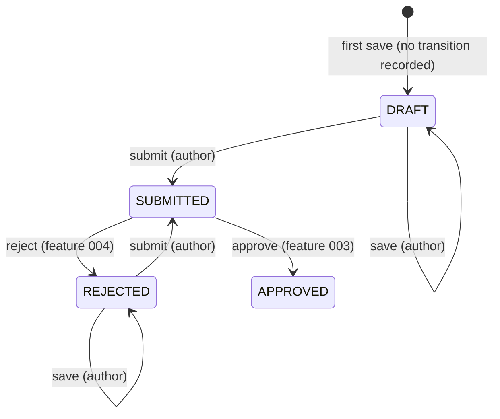

# Data model: Draft and submit a daily report

Phase 1 of [plan.md](./plan.md). Decisions are explained in [research.md](./research.md) (R1 to
R18). Rule IDs refer to [use-cases.md](../../docs/product/use-cases.md).

## 1. Domain model

### 1.1 `shared/domain`

| File | Name | Kind | Definition |
| --- | --- | --- | --- |
| `ids.ts` (new) | `WorksiteId`, `TaskId` | Branded strings | Moved from `worksite/domain`, with `toWorksiteId`, `toTaskId` (R1). `worksite/index.ts` still exports them |
| `progress.ts` (new) | `Progress` | Branded number | An integer from 0 to 100 (glossary). `isProgress(n)`, `toProgress(n)` (throws `RangeError`), `MIN_PROGRESS = 0`, `MAX_PROGRESS = 100` (R3) |
| `actor.ts`, `clock.ts`, `errors.ts` | | | Unchanged |

### 1.2 `worksite/domain` (changed)

| Name | Change |
| --- | --- |
| `Task.approvedProgress` | `number` → `Progress` (R3). The mapper converts with `toProgress` |
| `task.ts`, `worksite.ts` | Import `TaskId`, `WorksiteId` from `shared/domain/ids.ts` |

No behavior changes. `Worksite` must stay structurally assignable to `ReportWorksite` (1.3).

### 1.3 `reporting/domain`

| File | Name | Kind | Definition |
| --- | --- | --- | --- |
| `daily-report.ts` | `ReportWorksite`, `ReportTask` | Interfaces | What a report needs from its worksite: `id`, `status` (`"ACTIVE" \| "CLOSED"`), `supervisorId`, `tasks`; each task `id`, `name`, `approvedProgress`, `isAssignedTo(userId)`. `Worksite` fits structurally (R2) |
| `daily-report.ts` | `ReportStatus` | Const object and type | `DRAFT`, `SUBMITTED`, `REJECTED`, `APPROVED` (glossary) |
| `daily-report.ts` | `ALLOWED_TRANSITIONS` | Constant | Exactly 4 pairs: `DRAFT→SUBMITTED`, `SUBMITTED→APPROVED`, `SUBMITTED→REJECTED`, `REJECTED→SUBMITTED` (PRD, Report lifecycle) |
| `daily-report.ts` | `canTransition(from, to)` | Function | `true` only for the 4 pairs; the TST-11 table test covers all 16 |
| `daily-report.ts` | `assertTransition(from, to)` | Function | Throws `ConflictError("INVALID_STATUS_TRANSITION", …, { from, to })` (FR-018) |
| `daily-report.ts` | `isEditable(status)` | Function | `true` for `DRAFT` and `REJECTED` (BR-6) |
| `daily-report.ts` | `WorkDate` | Branded string | `YYYY-MM-DD`. `toWorkDate(value)` |
| `daily-report.ts` | `assertCanCreateReportFor(workDate, today, limitDays)` | Function | BR-2: `today − limitDays ≤ workDate ≤ today`, inclusive, by calendar arithmetic. Throws `RuleViolationError("WORK_DATE_OUT_OF_RANGE", …, { workDate, earliest, latest })` (R7) |
| `daily-report.ts` | `ReportTransition` | Value | `from: ReportStatus`, `to: ReportStatus`, `actorId: UserId`, `occurredAt: Date`, `reason: string \| null` (BR-11) |
| `daily-report.ts` | `ReportId` | Branded string | With `toReportId` |
| `report-item.ts` | `ReportItem` | Entity | `taskId: TaskId`, `reportedProgress: Progress`, `note: string \| null`. Identity: its task, within its report |
| `report-item.ts` | `ReportItem.create(taskId, reportedProgress, note)` | Factory | BR-5 range: throws `PROGRESS_OUT_OF_RANGE` naming the task when `!isProgress(reportedProgress)` (R5) |
| `daily-report.ts` | `DailyReport` | Aggregate root | See 1.4 |
| `daily-report.repository.ts` | `DailyReportRepository` | Port | See 1.5 |

### 1.4 `DailyReport`

State: `id: ReportId`, `worksiteId: WorksiteId`, `authorId: UserId`, `workDate: WorkDate`,
`status: ReportStatus`, `version: number`, `note: string | null`, `items: readonly ReportItem[]`,
`transitions: readonly ReportTransition[]` (oldest first).

`DraftContent = { note: string | null; items: readonly { taskId: TaskId; reportedProgress: number; note: string | null }[] }`

| Member | Checks, in order | Effect |
| --- | --- | --- |
| `static assertCanAuthor(actor)` | Role is `FOREMAN`, else `ForbiddenError("ROLE_CANNOT_AUTHOR_REPORTS")` (PRD Roles) | none |
| `static create({ id, author, worksite, workDate, today, backdateLimitDays, content })` | `assertCanAuthor`; BR-2 (`assertCanCreateReportFor`); BR-3; then each item: BR-4, BR-5 range | New report: `DRAFT`, version 1, no transitions |
| `static restore(props)` | none | Rebuilds from stored data |
| `edit(actor, worksite, content)` | `assertCanAuthor`; BR-6 author (`ForbiddenError("NOT_REPORT_AUTHOR")`); BR-6 status (`ConflictError("REPORT_NOT_EDITABLE", …, { status })`); BR-3; each item: BR-4, BR-5 range | Replaces `note` and the whole item list (FR-002). Status unchanged |
| `submit(actor, worksite, at: Date)` | `assertCanAuthor`; BR-6 author; `assertTransition(status, SUBMITTED)`; BR-3; BR-7; each item: BR-4, then BR-5 against `approvedProgress` | `status = SUBMITTED`; appends `ReportTransition(from, SUBMITTED, actor.id, at, null)` (BR-11) |
| `assertViewableBy(actor, worksite)` | Author: allowed. `worksite.supervisorId === actor.id` and status ≠ `DRAFT`: allowed. Else `ForbiddenError("REPORT_VIEW_FORBIDDEN")` (FR-030, R13) | none |

Shared private checks, each implemented once and citing its rule:

- **BR-3** `assertWorksiteActive(worksite)`: `worksite.status === "ACTIVE"`, else
  `RuleViolationError("WORKSITE_CLOSED")`.
- **BR-4** `assertItemsAllowed(worksite, items)`: for each item, in order: listed once
  (`TASK_LISTED_TWICE`), a task of `worksite` (`TASK_NOT_IN_WORKSITE`),
  `task.isAssignedTo(this.authorId)` (`TASK_NOT_ASSIGNED_TO_AUTHOR`). Each names the task.
- **BR-5 range** in `ReportItem.create`. **BR-5 against approved progress** in `submit`:
  `item.reportedProgress >= task.approvedProgress`, else `PROGRESS_BELOW_APPROVED` with the task's
  name and current approved progress.
- **BR-7** in `submit`: `items.length > 0`, else `REPORT_HAS_NO_ITEMS`.

`DailyReport` never changes `version`: the repository increments it on every write (R10).

### 1.5 `DailyReportRepository`

```ts
type AddResult = { readonly created: boolean; readonly report: DailyReport };

interface DailyReportRepository {
  findById(id: ReportId): Promise<DailyReport | undefined>;
  findByAuthorWorksiteAndDate(authorId: UserId, worksiteId: WorksiteId, workDate: WorkDate): Promise<DailyReport | undefined>;
  /** Inserts a new report and its items. On BR-1's unique key, returns the existing report with created: false (R8). */
  add(report: DailyReport): Promise<AddResult>;
  /** Writes the report conditionally on expectedVersion and increments it (BR-15); throws
   *  REPORT_VERSION_CONFLICT when stale. Returns the report as stored. */
  save(report: DailyReport, expectedVersion: number): Promise<DailyReport>;
}
```

Loaded reports list items by `updated_at` descending, `created_at`, `task_id` (FR-032), and
transitions by `occurred_at`, then `id` (FR-032, recorded exception).

### 1.6 `reporting/application`

| File | Use case | Input | Output | Steps |
| --- | --- | --- | --- | --- |
| `save-draft.ts` | `SaveDraft` | `actor`, `worksiteId`, `workDate`, `expectedVersion?`, `note`, `items` | `{ created: boolean; report: ReportView }` | `assertCanAuthor`; load worksite (`WORKSITE_NOT_FOUND`); find the caller's report for the worksite and date; then the four cases of R8 |
| `submit-report.ts` | `SubmitReport` | `actor`, `reportId`, `expectedVersion` | `ReportView` | `assertCanAuthor`; load report (`REPORT_NOT_FOUND`); compare version (`REPORT_VERSION_CONFLICT`); load worksite; `report.submit(actor, worksite, clock.now())`; `save` |
| `get-report.ts` | `GetReport` | `actor`, `reportId` | `ReportView` | Load report (`REPORT_NOT_FOUND`); load worksite; `assertViewableBy`. Writes nothing (FR-033) |

`get-report.ts` also exports `ReportView` and `toReportView(report)`, the response shape of
[contracts/report-view.md](./contracts/report-view.md), as `get-worksite.ts` exports
`WorksiteView`. `SaveDraft` and `SubmitReport` import them from there.

`SaveDraft` takes `DailyReportRepository`, `WorksiteRepository` (from `worksite/index.ts`),
`Clock` and `backdateLimitDays`. It creates the report ID with `crypto.randomUUID()`
(implementation plan, section 3). `SubmitReport` takes the two repositories and `Clock`.
`GetReport` takes the two repositories.

The early version check of R4 step 7 is in `SaveDraft` (edit case) and `SubmitReport`: when the loaded
`version` differs from `expectedVersion`, throw `REPORT_VERSION_CONFLICT` with `currentVersion`
before calling the aggregate.

## 2. Tables

All names `snake_case` (NAM-06). Every table has `created_at` and `updated_at`
(`timestamptz(6)`, default `now()`) and the `set_updated_at()` trigger (architecture.md section
5.5). Foreign keys are `ON DELETE RESTRICT`: nothing in the system deletes users, worksites, tasks
or reports.

### 2.1 Enum `report_status`

`DRAFT`, `SUBMITTED`, `REJECTED`, `APPROVED`. Prisma `enum ReportStatus` with
`@@map("report_status")`.

### 2.2 `daily_reports`

| Column | Type | Null | Default | Constraint |
| --- | --- | --- | --- | --- |
| `id` | `uuid` | no | | primary key |
| `worksite_id` | `uuid` | no | | FK `worksites(id)` |
| `author_id` | `uuid` | no | | FK `users(id)` |
| `work_date` | `date` | no | | |
| `status` | `report_status` | no | `'DRAFT'` | |
| `version` | `integer` | no | `1` | `CHECK (version >= 1)` (hand-written) |
| `note` | `text` | yes | | `CHECK (char_length(note) <= 2000)` (hand-written) |
| `created_at`, `updated_at` | `timestamptz(6)` | no | `now()` | trigger |

- `UNIQUE (worksite_id, author_id, work_date)`: BR-1 (DB-02). Named
  `daily_reports_worksite_id_author_id_work_date_key`; the repository recognizes `P2002` on it (R8).
- Index on `author_id`.

### 2.3 `report_items`

| Column | Type | Null | Default | Constraint |
| --- | --- | --- | --- | --- |
| `report_id` | `uuid` | no | | FK `daily_reports(id)` |
| `task_id` | `uuid` | no | | FK `tasks(id)` |
| `reported_progress` | `integer` | no | | `CHECK (reported_progress BETWEEN 0 AND 100)` (hand-written; BR-5) |
| `note` | `text` | yes | | `CHECK (char_length(note) <= 2000)` (hand-written) |
| `created_at`, `updated_at` | `timestamptz(6)` | no | `now()` | trigger |

- Primary key `(report_id, task_id)`: BR-4, a task at most once per report (R12).
- Index on `task_id`.

### 2.4 `report_transitions`

| Column | Type | Null | Default | Constraint |
| --- | --- | --- | --- | --- |
| `id` | `uuid` | no | | primary key; supplied by the repository |
| `report_id` | `uuid` | no | | FK `daily_reports(id)` |
| `from_status` | `report_status` | no | | |
| `to_status` | `report_status` | no | | |
| `actor_id` | `uuid` | no | | FK `users(id)` |
| `occurred_at` | `timestamptz(6)` | no | | from `Clock.now()` (BR-11, ARC-10) |
| `reason` | `text` | yes | | |
| `created_at`, `updated_at` | `timestamptz(6)` | no | `now()` | trigger |

- Index on `(report_id, occurred_at)`.
- Trigger `report_transitions_append_only`, `BEFORE UPDATE OR DELETE`, raises
  `report_transitions is append-only` (BR-11, FR-020). It sorts before
  `report_transitions_set_updated_at`, so it fires first.

### 2.5 `idempotency_keys`

| Column | Type | Null | Default | Constraint |
| --- | --- | --- | --- | --- |
| `actor_id` | `uuid` | no | | FK `users(id)` |
| `key` | `text` | no | | `CHECK (char_length(key) BETWEEN 1 AND 255)` (hand-written) |
| `request_hash` | `text` | no | | SHA-256, hex |
| `response_status` | `integer` | yes | | |
| `response_body` | `jsonb` | yes | | |
| `completed_at` | `timestamptz(6)` | yes | | |
| `created_at`, `updated_at` | `timestamptz(6)` | no | `now()` | trigger |

- Primary key `(actor_id, key)`: BR-14, a key belongs to its actor (FR-025).
- `CHECK ((response_status IS NULL) = (completed_at IS NULL) AND (response_body IS NULL) = (completed_at IS NULL))`
  (hand-written): a claim is either in progress (all three null) or completed (all three set).

### 2.6 Hand-written migration SQL

The migration `<timestamp>_create_reporting_tables` is generated by
`npx prisma migrate dev --name create_reporting_tables`, then gains, before it is committed
(architecture.md 5.1, DB-05):

- the five `CHECK` constraints above (`version`, two `note` lengths, `reported_progress`, `key`
  length, idempotency completion);
- `set_updated_at` triggers on the four new tables (the function exists since feature 001);
- the function `reject_report_transition_change()` and the trigger
  `report_transitions_append_only`.

## 3. Mapping

| Domain | Row | Notes |
| --- | --- | --- |
| `DailyReport` | `daily_reports` + `report_items` + `report_transitions` | `daily-report.mapper.ts`; `toWorkDate` from the `date` column formatted `YYYY-MM-DD` in UTC |
| `ReportItem` | `report_items` | `reportedProgress` via `toProgress` (the `CHECK` guarantees the range) |
| `ReportTransition` | `report_transitions` | `id`, `created_at`, `updated_at` not mapped |
| `ReportStatus` | `report_status` | Exhaustive `switch` ending in `assertNever` (TS-06), as `worksite.mapper.ts` does |

Prisma types stay in `reporting/infrastructure` (ARC-08).

## 4. State transitions



A save does not change the status and records no transition. Every arrow labelled submit, approve
or reject records one `ReportTransition` (BR-11). Every other pair of statuses is refused with
`INVALID_STATUS_TRANSITION` (FR-018). In this feature, `REJECTED` and `APPROVED` reports exist only
as prepared test data (R17).

## 5. Example data used by the walkthrough

No new seed rows. The walkthrough uses feature 001's fixed IDs:

| Name | ID |
| --- | --- |
| Linda (Site Supervisor) | `00000000-0000-4000-8000-000000000001` |
| Mark (Foreman) | `00000000-0000-4000-8000-000000000002` |
| Henry (Foreman) | `00000000-0000-4000-8000-000000000003` |
| Three-storey townhouse | `00000000-0000-4000-8000-000000000101` |
| Build ground-floor walls (Mark, 40%) | `00000000-0000-4000-8000-000000000202` |
| Install electrical (Henry, 0%) | `00000000-0000-4000-8000-000000000203` |

Report IDs are generated (`crypto.randomUUID()`), so the walkthrough reads the ID from the save's
response.
