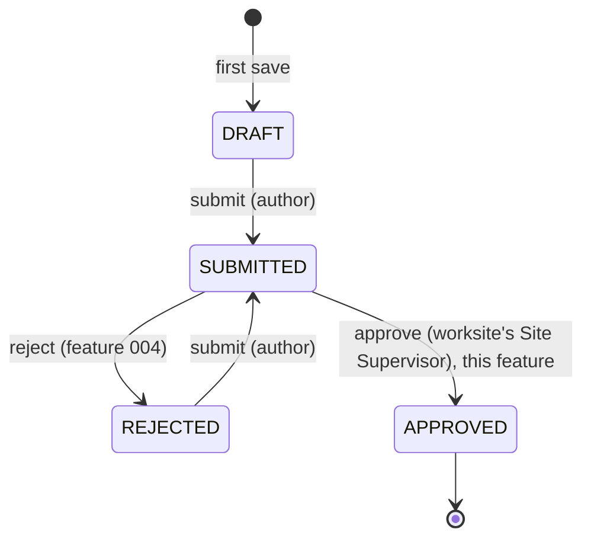

# Data model: Approve a daily report

Phase 1 of [plan.md](./plan.md). Decisions are explained in [research.md](./research.md) (R1 to
R10). This feature adds **no table, column, constraint or migration**: it reads and writes tables
created by features 001 and 002. The base model is in
[002's data-model.md](../002-draft-and-submit/data-model.md).

## 1. Domain model

### 1.1 `reporting/domain/daily-report.ts` (changed)

| Name | Kind | Definition |
| --- | --- | --- |
| `OutdatedItem` | Interface | `taskId: TaskId`, `taskName: string`, `reportedProgress: Progress`, `approvedProgress: Progress`: one item whose task's approved progress is above it (R3) |
| `progressOutdated(items)` | Function | Builds `RuleViolationError("REPORT_PROGRESS_OUTDATED", message listing every item, { tasks: items })`. Used by `DailyReport.approve` and by the repository's guard, so both answer the same way (R3) |
| `DailyReport.assertCanApprove(actor, worksite)` | Method | BR-12, plus the draft rule of FR-009. See 1.2 |
| `DailyReport.approve(actor, worksite, at: Date)` | Method | UC-3. See 1.2 |

`ReportStatus`, `ALLOWED_TRANSITIONS`, `assertTransition` and `ReportTransition` are unchanged.
`SUBMITTED → APPROVED` is already one of the four transitions (002 FR-018), so the TST-11 table
test does not change.

### 1.2 `DailyReport`: new members

| Member | Checks, in order | Effect |
| --- | --- | --- |
| `assertCanApprove(actor, worksite)` | `actor.role === SITE_SUPERVISOR` and `actor.id === worksite.supervisorId` (BR-12), and `status !== DRAFT` (FR-009). Any failure: `ForbiddenError("REPORT_APPROVAL_FORBIDDEN", …, { reportId })`, one code and message for every case (R2) | none |
| `approve(actor, worksite, at)` | `assertCanApprove`; `assertTransition(status, APPROVED)` (BR-10: `INVALID_STATUS_TRANSITION` for `APPROVED` and `REJECTED`); BR-5 for **every** item: `item.reportedProgress >= task.approvedProgress`, collecting each failure, then `progressOutdated(failures)` if any | `status = APPROVED`; appends `ReportTransition(SUBMITTED, APPROVED, actor.id, at, null)` (BR-11). Items, note, author, worksite and work date unchanged (FR-005) |

Not checked by `approve`: the worksite's status (BR-3) and each task's assignee (BR-4), as FR-008
requires. A task missing from the worksite cannot occur (002 BR-4 at save and submit, and tasks are
never deleted); if it did, `approve` throws a plain `Error`, which is a `500`, as `SubmitReport`
does for a missing worksite.

The version is not changed by the aggregate; the repository increments it (002 R10).

### 1.3 `DailyReportRepository` (changed)

```ts
interface DailyReportRepository {
  // … findById, findByAuthorWorksiteAndDate, add, save: unchanged (feature 002)

  /**
   * Writes an approval in one transaction (ADR 0004, BR-9): the report conditionally on expectedVersion and
   * status SUBMITTED (BR-15), each task's approved progress raised to the reported progress only when below it,
   * in ascending task ID order, a task not raised checked not to be above it (BR-5 guard), and the new
   * transition (BR-11). A task already at the reported value is not written. Any failed condition rolls back
   * everything. Throws REPORT_VERSION_CONFLICT or REPORT_PROGRESS_OUTDATED. Returns the report as stored.
   */
  saveApproval(report: DailyReport, expectedVersion: number): Promise<DailyReport>;
}
```

### 1.4 `reporting/application/approve-report.ts` (new)

| Use case | Input | Output | Steps |
| --- | --- | --- | --- |
| `ApproveReport` | `actor`, `reportId`, `expectedVersion` | `ReportView` | Load the report (`REPORT_NOT_FOUND`); load its worksite; `report.assertCanApprove(actor, worksite)`; compare version (`REPORT_VERSION_CONFLICT` with `currentVersion`); `report.approve(actor, worksite, clock.now())`; `reports.saveApproval(approved, expectedVersion)`; `toReportView` |

Constructor `(reports: DailyReportRepository, worksites: WorksiteRepository, clock: Clock)`, as in
testing.md's example. It reuses `reportNotFound` from `submit-report.ts` and `versionConflict` from
`save-draft.ts`, and `ReportView`, `toReportView` from `get-report.ts`.

## 2. Tables

No change to the schema. What the approval reads and writes, in one transaction (R4):

| Table | Read | Write | Condition |
| --- | --- | --- | --- |
| `daily_reports` | the row | `status = 'APPROVED'`, `version = version + 1` (and `updated_at` by trigger) | `id`, `version = expected`, `status = 'SUBMITTED'` |
| `tasks` (owned by `worksite`) | name and `approved_progress` of the tasks not raised; any above the reported progress fails the approval | `approved_progress = reported_progress` (and `updated_at` by trigger), only for tasks below it, ascending `id`; a task at the reported value is not written | `id`, `worksite_id`, `approved_progress < reported_progress` |
| `report_transitions` | count, as in `save` | one row: `SUBMITTED → APPROVED`, actor, `occurred_at`, `reason` null | append-only (002) |
| `report_items` | for the reload | none | |

The existing constraints still apply: `CHECK (approved_progress BETWEEN 0 AND 100)` on `tasks`
(feature 001) and the `report_transitions` append-only trigger (002). Every task in a report
belongs to the report's worksite (002 BR-4), so the `worksite_id` condition never excludes a valid
item.

## 3. Mapping

Unchanged. `daily-report.mapper.ts` already maps every status, and the worksite mapper reads the
new approved progress like any other value.

## 4. State transitions



`APPROVED` is final (BR-10): every action on an `APPROVED` report is refused, stating the status.
After this feature, `APPROVED` is reachable through the API; `REJECTED` still exists only as
prepared test data.

## 5. Example data used by the walkthrough

No new seed rows. Feature 002's walkthrough ends with Mark's report for 20 November `SUBMITTED` at
version 3, Build ground-floor walls at 55%. Linda approves it from version 3. The IDs are in
[002's data-model.md](../002-draft-and-submit/data-model.md), section 5.

| Task | Approved progress before | After Linda approves |
| --- | --- | --- |
| Pour foundation | 100% | 100% |
| Build ground-floor walls | 40% | 55% |
| Install electrical | 0% | 0% |
