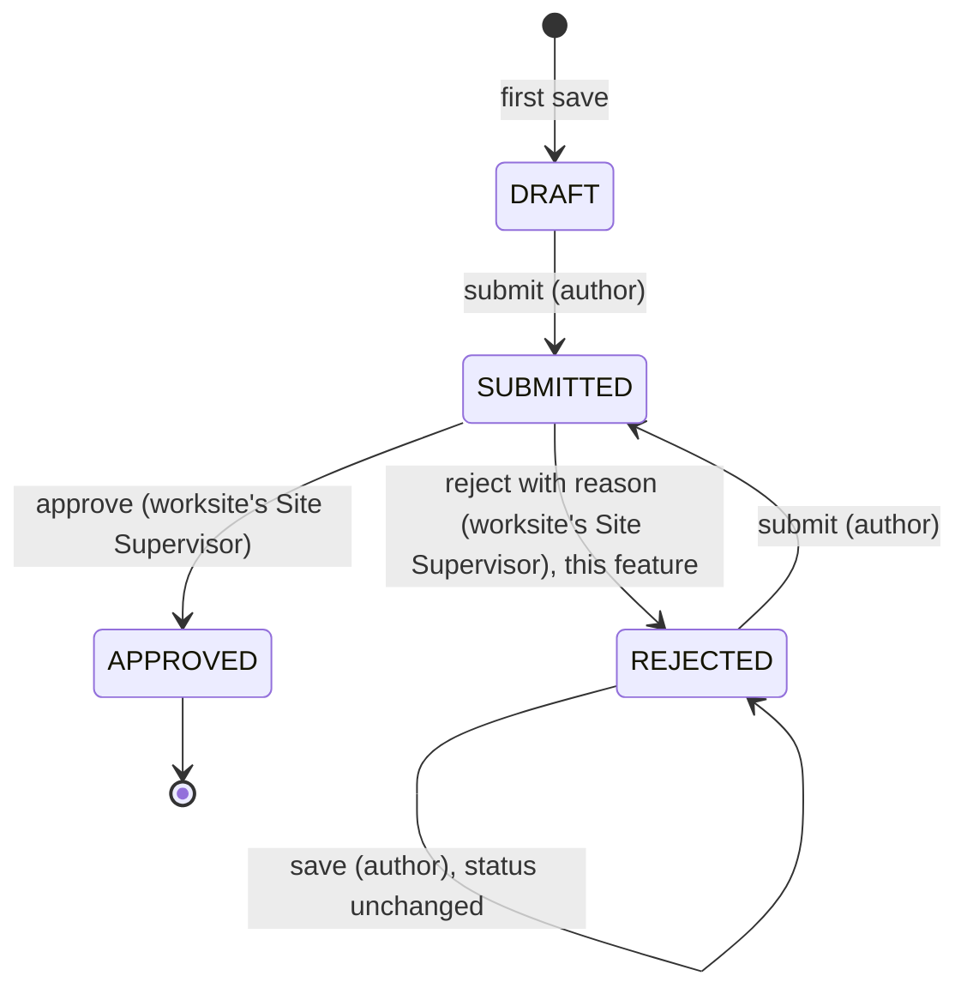

# Data model: Reject and resubmit a daily report

Phase 1 of [plan.md](./plan.md). Decisions are explained in [research.md](./research.md) (R1 to
R12). This feature adds **no table or column**. It adds **two `CHECK` constraints** to
`report_transitions` in one new migration (R5). The base model is in
[002's data-model.md](../002-draft-and-submit/data-model.md); approval is in
[003's data-model.md](../003-approve-report/data-model.md).

## 1. Domain model

### 1.1 `reporting/domain/daily-report.ts` (changed)

| Name | Kind | Definition |
| --- | --- | --- |
| `DailyReport.assertDecidableBy(actor, worksite, refusal)` | Private method | BR-12, plus the draft rule: allows only `actor.role === SITE_SUPERVISOR` and `actor.id === worksite.supervisorId`, for a report that is not `DRAFT`. Otherwise throws `refusal()`. The one implementation of the rule (R2) |
| `DailyReport.assertCanApprove(actor, worksite)` | Method, changed inside | Calls `assertDecidableBy` with the `REPORT_APPROVAL_FORBIDDEN` error. Behavior, code and message unchanged (003) |
| `DailyReport.assertCanReject(actor, worksite)` | Method, new | Calls `assertDecidableBy` with `ForbiddenError("REPORT_REJECTION_FORBIDDEN", …, { reportId })` (R2) |
| `DailyReport.reject(actor, worksite, reason, at)` | Method, new | UC-4. See 1.2 |

`ReportStatus`, `ALLOWED_TRANSITIONS`, `assertTransition`, `VERB_FOR` and `ReportTransition` are
unchanged. `SUBMITTED → REJECTED` and `REJECTED → SUBMITTED` are already two of the four
transitions (002 FR-018), and `VERB_FOR.REJECTED` is already `"rejected"`, so the TST-11 table test
does not change. `edit`, `submit` and `assertViewableBy` are unchanged (R7).

### 1.2 `DailyReport.reject`

| Step | Check | Error |
| --- | --- | --- |
| 1 | `assertCanReject(actor, worksite)` (BR-12; a `DRAFT` gets the same answer, FR-008) | `403 REPORT_REJECTION_FORBIDDEN` |
| 2 | `assertTransition(status, REJECTED)` (BR-10 for `APPROVED`; lifecycle for `REJECTED`) | `409 INVALID_STATUS_TRANSITION` |
| 3 | `reason !== null && reason.trim() !== ""` (BR-8) | `422 REJECTION_REASON_REQUIRED` |

Effect: `status = REJECTED`; appends `ReportTransition(SUBMITTED, REJECTED, actor.id, at, reason)`
with `reason` as given (BR-11; Clarifications Q4). Items, note, author, worksite and work date
unchanged (FR-006). Not checked: worksite status (BR-3), assignees (BR-4), approved progress (BR-5)
(FR-007). The version is not changed by the aggregate; the repository increments it (002 R10).

Signature: `reject(actor: Actor, worksite: ReportWorksite, reason: string | null, at: Date): DailyReport`.

### 1.3 `DailyReportRepository`

Unchanged. Rejection uses `save(report, expectedVersion)` (R4).

### 1.4 `reporting/application/reject-report.ts` (new)

| Use case | Input | Output | Steps |
| --- | --- | --- | --- |
| `RejectReport` | `actor`, `reportId`, `expectedVersion`, `reason: string \| null` | `ReportView` | Load the report (`REPORT_NOT_FOUND`); load its worksite; `report.assertCanReject(actor, worksite)`; compare version (`REPORT_VERSION_CONFLICT` with `currentVersion`); `report.reject(actor, worksite, reason, clock.now())`; `reports.save(rejected, expectedVersion)`; `toReportView` |

Constructor `(reports: DailyReportRepository, worksites: WorksiteRepository, clock: Clock)`, as
`ApproveReport`. It reuses `reportNotFound`, `toReportView` and `ReportView` from `get-report.ts`,
and `versionConflict` from `save-draft.ts`.

## 2. Tables

### 2.1 What a rejection reads and writes

One `$transaction`, the existing `save` (R4):

| Table | Read | Write | Condition |
| --- | --- | --- | --- |
| `daily_reports` | the row | `status = 'REJECTED'`, `version = version + 1`, `note` (unchanged value); `updated_at` by trigger | `id`, `version = expected` |
| `report_items` | the report's items | none: no item differs, so `writeItems` writes nothing | |
| `report_transitions` | count | one row: `SUBMITTED → REJECTED`, actor, `occurred_at`, `reason` | append-only (002); the new `CHECK`s below |
| `tasks` | none | none | |

Editing and resubmitting a `REJECTED` report write exactly what feature 002's save and submit
write.

### 2.2 New migration: `add_transition_reason_checks`

Created with `npx prisma migrate dev --create-only --name add_transition_reason_checks`
(`schema.prisma` unchanged, so the generated file is empty), then filled by hand (constitution VI):

| Constraint | On | Definition | Guards |
| --- | --- | --- | --- |
| `report_transitions_reason_length` | `report_transitions` | `CHECK (char_length("reason") <= 2000)` | FR-003, as `daily_reports_note_length` does for notes |
| `report_transitions_rejection_reason` | `report_transitions` | `CHECK ("to_status" <> 'REJECTED' OR ("reason" IS NOT NULL AND "reason" ~ '\S'))` | BR-8, SC-005 |

Both hold for every existing row: no transition has a reason over 2,000 characters, and no
`REJECTED` transition exists outside tests, which prepare one with a reason. Adding the constraints
does not update rows, so the append-only trigger does not fire (R5). The domain's `trim()` is at
least as strict as `~ '\S'`, so the guard never refuses a rejection the domain accepted (R3).

## 3. Mapping

Unchanged. `daily-report.mapper.ts` already maps `reason` in both directions.

## 4. State transitions

`REJECTED → REJECTED` is a save, not a transition: no transition is recorded and the TST-11 table
still refuses it as a status change. After this feature every status is reachable through the API.

## 5. Example data used by the walkthrough

No new seed rows. Mark's report follows feature 003's walkthrough. Henry's report for 20 November
is new (R8):

| Step | Henry's report | Version | Walls | Electrical |
| --- | --- | --- | --- | --- |
| Henry drafts Install electrical at 10% | `DRAFT` | 1 | 40 | 0 |
| Henry submits (Mark's report also submitted) | `SUBMITTED` | 2 | 40 | 0 |
| Linda approves Mark's report | `SUBMITTED` | 2 | 55 | 0 |
| Linda rejects: "conduit laid, no wiring pulled yet" | `REJECTED` | 3 | 55 | 0 |
| Henry saves electrical at 5% | `REJECTED` | 4 | 55 | 0 |
| Henry resubmits | `SUBMITTED` | 5 | 55 | 0 |
| Linda approves | `APPROVED` | 6 | 55 | 5 |

Install electrical's ID is `00000000-0000-4000-8000-000000000203`; the other IDs are in
[002's data-model.md](../002-draft-and-submit/data-model.md), section 5.
